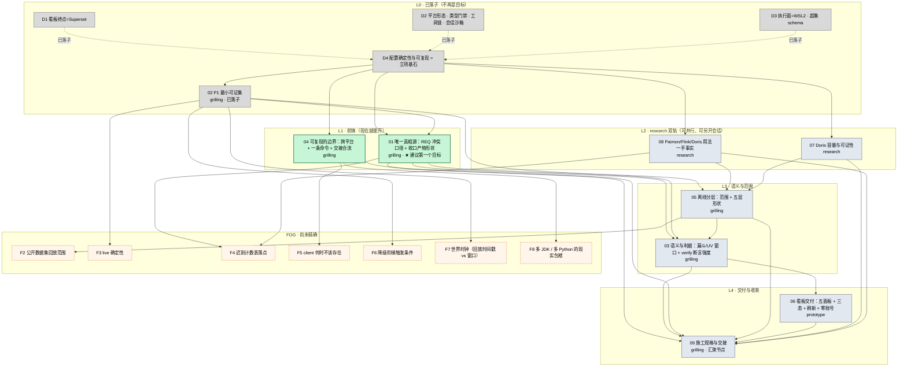

# 可选目标 DAG（wayfinder 地图 · 依赖关系图）

> **性质**：`map.md` 的**辅助视图**，不是权威。权威在地图正文与各票文件；本图只回答「先解哪个、解了它才轮到谁」。
> **日期**：2026-10-20（第二轮：11 票精简为 9 票后重画）
> **节点**：`NN`＝本目录 `issues/NN-<slug>.md` 的票；`Dn`＝地图 Decisions so far 的正文级已决；`F*`＝迷雾（见 `map.md` 的 Not yet specified）。
> **边**：`A → B`＝「A 决出来之前，B 的问题没法精确表述或没法裁决」。

## 图

## 分层与入边

| 层 | 票 | 类型 | Blocked by | 为什么在这一层 |
| --- | --- | --- | --- | --- |
| **L0** | **02 P1 最小可证集** | grilling | D4 | **已落子**：收窄为「P1 的成功判据」，圈表仍待裁 |
| **L1** | **01 唯一真相源** | grilling | **02**（＝D4） | **建议第一个目标**：它是根，且不碰任何机器 |
| **L1** | **04 可复现的边界** | grilling | **02**（＝D4） | 与 01 并列的前锋；含三份 P0 交接的合流 |
| L2 | **07 Doris 容量与可证性** | research | 02 | 只查官方语义，可另开会话并行 |
| L2 | **08 Paimon/Flink/Doris 用法一手事实** | research | 02 | 四组事实打包，一次 research 会话可全出 |
| L3 | **03 语义与判据** | grilling | 02, 05 | 判据口径要用到 01 的「行为可证」与 05 的窗口边界 |
| L3 | **05 离线分层范围** | grilling | 02 | 上依赖 08 的事实、07 的成本；形状重一点，是这一层最重的一张 |
| L4 | **06 看板交付** | prototype | 03 | 「暂定/落定/已修订」画得准不准，取决于 03 的语义 |
| L4 | **09 施工规格与交接** | grilling | 其余全部 | **汇聚节点**：只有它 resolved，地图才算完成 |

## 为什么是 9 票（第二轮精简说明）

| 原票 | 处置 | 理由 |
| --- | --- | --- |
| 01 Paimon × Flink SQL-only | 并入 **08** | 与「Flink SQL 迟到侧输出」「Doris MoW 部分列」是同一批「一手事实」研究，分开开三次 research 只会重复读同一批官方页 |
| 02 schema 版本化 + 原 10 离线 schema 演化 | 并入 **01** | 两者都是「收口后的文档长什么样」——版本号写到哪一行、DDL 的键与分区长什么样，属于同一张口径表 |
| 原 05 漏斗/UV 语义 + 原 09 verify 判据强度 | 合并为 **03** | 语义与判据是同一件事的两面：这个量是什么，决定了怎么判它对没对 |
| 原 08 离线门槛 + 原 10 离线 schema | 合并为 **05** | 「P2 放哪」与「五层长什么样」在同一张表里一起答更省事 |
| 原 11 看板原型 + 原 09 的脏率/交付形态 | 合并为 **06** | 都是「看板怎么交付、怎么证」，原型是手段 |
| 原 07 Doris 动态分区 | 保留 **07**，扩成「容量与可证性」 | 30 天保留的成本与 Kafka 保留窗的可证性属同类问题 |
| 原 06 跨平台 | 保留 **04**，并入「交接合流」执行面 | D4 把合流留给了执行面，放在这里一次做完 |
| — | 新增 **09** 施工规格与交接 | 目的地是「spec-ready 路线图」，落地动作需要一张汇聚票 |

迷雾从 13 条降到 8 条：**F1（schema 版本化）升级进 01**；F6（Superset delivery）并入 06；F8/F10/F12 三条（verify 边界、保留窗、对账口径）并入 03 / 07 / 05 的正文；F9（降级触发）与 F11（拉链判据）分别并入 F6 与 05 的正文；F13（Paimon compaction 成本）并入 08/07。

## 缺口（读图时不要当成已覆盖）

1. **`REQ-F-LAKE-08` 的验收判据措辞**：SRS「受控为 5」vs gdd D7「5 是下限」。约定是 [01] 收口口径、[05] 给形状、[08] 给规范原文——**三张票各管一段，任何一张单独 resolved 都不等于它闭合**。
2. **`REQ-F-ORCH-05` 的拓扑**：`client` 的服务依赖、「一条命令」、`down/up` 不丢数据三者可能成环。归 [04] 的第 4 问。
3. **P1 圈表**：`[02]` 的产物是这张图的**输入**而不是节点；它定下来后 F2/F3/F6/F7 会按圈重排，届时重画一次。

## 怎么读

- **绿**：现在就能开（[01]、[04]）。**灰**：已落子，只作上下文。**橙虚线**：迷雾，不要预设成票。
- **一次会话只解一张**（research 可批量）；解前先把 `Status: claimed` 写盘，避免两个会话撞车。
- **图会变**：每解一张票重画一次；新增节点「先建票、后补边」，边写进票的 `Blocked by:` 行，图逐条对齐。
