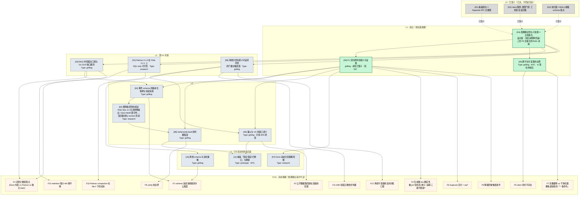

# 可选目标 DAG（wayfinder 地图 · 依赖关系图）

> **性质**：`map.md` 的**辅助视图**，不是权威。权威在地图正文与各票文件；本图只回答「先解哪个、解了它才轮到谁」。
> **日期**：2026-10-20（Asia/Shanghai）
> **节点命名**：`[NN] 票名`＝本目录 `issues/NN-<slug>.md` 的票；`(F*)`＝迷雾区条目（见 `map.md` 的 **Not yet specified**，尚不可开票）；`(D*)`＝地图 Decisions-so-far 的既有条目。
> **边**：`A → B` 读作「**A 决出来之前，B 的问题没法精确表述或没法裁决**」。

## 图

## 分层与入边（同图，纯文本备份）

「入边」一列即 Mermaid 里指向该节点的箭头来源；**入边全 resolved 时该票进入 frontier**。

| 层 | 节点 | 类型 | 入边（Blocked by） | 为何在这一层 |
| --- | --- | --- | --- | --- |
| L0 | (D1) 看板终点 | 已决 | — | HLD §3.5/§8-R6 已排除七项候选 |
| L0 | (D2) client / 类型门禁 / 工具链 / 会话沙箱 | 已决 | — | HLD §3.2–3.4、§4.4、§4.6 |
| L0 | (D3) 执行面 WSL2 / 超集 schema 落点 | 已决 | — | HLD §4.7（含一次推翻）、§4.8、§7.2 G-D15 |
| **L1** | **(D4) 配置确定性与可复现** | 地图票（已落子） | D1–D3 | **立项基石**：它不决定「做什么」，决定「凭什么是可复现的」 |
| **L1** | **[04] P1 实时闭环的最小可证集** | grilling | D4 | **本轮已落子**（map landing 一并裁决）：收窄为「P1 的成功判据」，圈表仍待你裁决 |
| **L1** | **[06] 跨平台可复现的边界** | grilling | D4 | **现在唯一的前沿**（`[04]` 落子后解封）；决定 05/10 里所有实验的可信度 |
| L2 | [03] REQ 冲突裁决口径与 D1–D15 收口顺序 | grilling | D4 | 不先定「谁该让路」，02/11/07 的裁决会各按各的定义走 |
| L2 | [01] Paimon 2.1.0 × Flink 2.2.1 SQL-only | research | D4 | D4 先定「可复现」对 Paimon 意味着什么；且 `REQ-F-LAKE-08` 与 SRS 判据冲突（见下方缺口） |
| L2 | [08] 离线分层的门槛与触发面 | grilling | D4 | 依赖 04 的「实时」边界，但门槛本身可先议 |
| L3 | [02] schema 版本化铁律与演进演练 | grilling | 03, 04 | 要看 04 先给「演练」的位置与验收强度 |
| L3 | [02] 的两条 research | research | 02 | **证伪/证实 gdd D11、D12 与 `revision` 形状**；只影响 F4，不影响 02 自身 |
| L3 | [09] verify/verify-fault 判据强度 | grilling | 02, 04 | 断言细节要等字段铁律（02）与 P1 边界（04） |
| L3 | [05] 漏斗与 UV 的窗口语义 | grilling | 04, 08 | 需要两条时间线的门槛一起定 |
| L4 | [07] Doris 动态分区策略真相 | research | 04 | 只锁「30 天」与看板刷新语义；成本先于方案 |
| L4 | [10] 离线 schema 与演化策略 | grilling | 08 | Paimon 五层内部形状；与 02 分属两条时间线 |
| L4 | [11] 看板暂定/落定/已修订 | prototype | 05, 09 | 要 05 的窗口单位、09 的修订可见性才画得准 |
| FOG | F1…F13 | — | 见「迷雾依赖」 | 现在**写不出**精确的问题，写清楚了当新票 |

## 迷雾依赖（每条迷雾挂在哪个节点上）

| 迷雾 | 挂在 | 一旦解决了它会变成 |
| --- | --- | --- |
| F1 schema 演进演练做到什么程度 | [02]（部分被 [04] 的圈表改写） | 可能是 `gdd F5` 的验收细化票，也可能判定「不演练、只留 `ext_field`」 |
| F2 公开数据集回放在首版的范围 | [05]（P1 圈表会把「首版」定死） | `REQ-F-LAKE-09` 的落地票，或明确 out of scope（`D4` 与规则①的关系） |
| F3 生成器 live 确定性（pin+种子+速率不相容） | [04] | `REQ-F-GEN-06` 的分模式判据票 |
| F4 迟到计数表落点 | [03] / [01] | 一张落点票（Doris 内表 vs `late_*` 表 vs 独立 topic） |
| F5 `client` 何时不存在 | [06] | 跨平台路径表里的一行，或一个 profile |
| F6 Superset 交付形态是否 = zip | [04] | 与 `REQ-F-BI-01..04` 对齐的交付票 |
| F7 含数据卷 vs 干净机器，哪条是「一条命令」 | [06] | 冷启动/复现口径的判据定义 |
| F8 `verify` 的边界（含不含 typecheck/lint） | [09] | `gdd` 与 `SRS` 判据的最终措辞 |
| F9 降级阶梯的触发条件 | [04] | HLD §8 降级表的启用条件 |
| F10 2 GB 上限实际保留窗 ~6h 够不够 | [03] | `REQ-F-MQ-03` 的冻结项变更提案（若需要） |
| F11 DIM 拉链正确性的判据 | [08] | `gdd D6.1` 拉链判据的断言形态 |
| F12 离线不变量断言的对账口径 | [08] | 对上 `dwd_behavior_event_reject` 的精确等式 |
| F13 Paimon compaction 在 `file://` 下的成本 | [01] | `REQ-F-LAKE-08` 的成本侧裁决 |

**读取方式**：迷雾的「挂在」一列**不**是阻塞边，是「谁的答案会把它变成一句可开票的问题」。`[04]` 落子后，F3/F6/F9 的挂点仍然是 `[04]`——因为圈表还没定。

## 图上的缺口（读图时不要当成已覆盖）

1. **没有节点拥有 `REQ-F-LAKE-08` 的验收判据冲突**：SRS 写「快照数受控为 5」，gdd D7/§1.4 已证伪为「5 是下限」。本轮只开了成本侧的 [07] 与规范侧的 [01]，**验收判据的最终措辞仍无人负责**——它大概该落在 [09]（判据强度）或 [03]（REQ 收口）的答案里。图按现状画，不虚增节点。
2. **`REQ-F-ORCH-05` 的拓扑**：`client` 的 `depends_on: service_healthy` 与「一条命令」、`down/up` 保住数据之间可能有循环依赖（`client` 等全链路健康，全链路里有 Doris，Doris 的初始化又走 `client`）。P0 实测只证了 `client` 单独跑通，**没证这条链**。它属于 F5/F7 一带，不单开票。
3. **P1 圈表本身不在图上**：`[04]` 的产物（PI-1 / PI-2 / PI-3 三圈）是本图的**输入**而不是节点——它定了以后，F1–F13 会按圈重排，届时这张图要整体重画一次。

## 两条明确的读图反例

- **不要把 `prototypes/` 里的三个 HTML 当成目标**：它们是 `gdd §E` 的一手证据，已在库里；本图的 [11] 要的是**第四个**原型（Superset 约束下的三态呈现），不是重跑旧的。
- **不要把 [07] 当成「修 Doris」**：动态分区在 30 天窗口内不触发删除，[07] 是**可证性**调研，不是实现任务。

## 怎么读这张图

- **前沿（绿色）**：`(D4)` 已落子 ⇒ `[04]` 已在本轮落子 ⇒ **现在唯一可开的是 `[06]`**；若你要先解圈表，把 `[04]` 的 `Status` 改回 `open` 即可，其余不动。**一次会话只解一张**（research 票例外）。
- **橙色虚线**：迷雾。**不要**把迷雾预设成票——`[04]` 解出来后，F3/F6/F9 会自己长成票或消失。
- **灰色**：已决，只作上下文；它们的论据在各票的 `## Answer` 里。
- **图会变**：每解一张票，重画一次。新增节点走「先建票、后补边」，边写进票文件的 `Blocked by:` 行，图与之逐条对齐。
