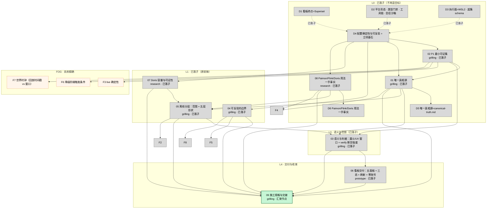

# 可选目标 DAG（wayfinder 地图 · 依赖关系图）

> **性质**：`map.md` 的**辅助视图**，不是权威。权威在地图正文与各票文件；本图只回答「先解哪个、解了它才轮到谁」。
> **日期**：2026-10-20（第五轮：[03] 落子后重画）
> **节点**：`NN`＝本目录 `issues/NN-<slug>.md` 的票；`Dn`＝地图 Decisions so far 的正文级已决；`F*`＝迷雾（见 `map.md` 的 Not yet specified）。
> **边**：`A → B`＝「A 决出来之前，B 的问题没法精确表述或没法裁决」。

## 图

## 分层与入边

| 层 | 票 | 类型 | Blocked by | 为什么在这一层 |
| --- | --- | --- | --- | --- |
| **L0** | **02 P1 最小可证集** | grilling | D4 | **已落子**：收窄为「P1 的成功判据」，圈表仍待裁 |
| **L0** | **01 唯一真相源** | grilling | 02（＝D4） | **已落子**：产出 [`canonical-truth.md`](../canonical-truth.md)——双轨权威模型、封闭处置词表、12 条冲突裁决、3 组规则铁律 |
| **L1** | **04 可复现的边界** | grilling | **02**（＝D4） | **已落子**：产出 [`reproducibility-boundary.md`](../reproducibility-boundary.md)——主体＝制品、四档契约 L0–L3、「一条命令」＝`make init`、`client` 两平台必需性、能力×平台成立性表、交接合流清单；产出 **D7**；并**收掉迷雾 F5、F8** |
| L1 | **07 Doris 容量与可证性** | research | 02 | **已落子**：产出 [research/07](../research/07-doris-dynamic-partition-retention.md) 与 **D8**；判据定为「配置＋小时级演练」；gdd D8/D3 两处被推翻（修订归 [09]）；三张实机 task 待开 |
| L0 | **08 Paimon/Flink/Doris 用法一手事实** | research | 02 | **已落子**：四组一手事实归档于 [08](08-lake-shaping-and-schema-evolution.md#answer) 与 `research/08a·08b·08c`；产出 **D6**（14 条副作用面，其中 8 条改变已有设计） |
| L1 | **05 离线分层范围** | grilling | 02, 08 | **已落子**（2026-10-20，⇒ **D9**）：18 问全按推荐——强序＋判据分层（`verify` 第三项 P1 阶段显式 SKIP）、dump 门槛批（104 万/3 天）、单目标 `replay`+`LAYER=`、五层形状表（`dt` 分区、DWD `(dt,event_id)`、DIM 拉链 `valid_from_ms/valid_to_ms` 区间 join、ADS 与 Doris 键同构＝两套物化一个口径）、快照 [5,20]、不变量改 A1/A2/A3、全 SQL 零 jar、warehouse 具名卷硬约束；对 [08] 两处订正（R1/R2）；**收口迷雾 F2、F4**；5 项批准已签，落笔归 [09] |
| L3 | **03 语义与判据** | grilling | 02, 05 | **已落子**（2026-10-20，⇒ **D10**）：10 问一轮全按推荐——修正面＝窗口聚合行＋漏斗行（TTL 32 min＝30 min 会话＋2 min 允许延迟，`revision` 两表同构）、暂定/落定/修正同表同一行（单键三态，D1 主防无需重证）、对账断言只比 `is_settled=1` 且 P1 显式 SKIP、漏斗唯一键不含 revision（单调只押 `cnt_inferred`）、`verify` 分层进码（P1 4 真＋1 SKIP、场景依赖判据带前置标记、幂等不进每次 verify）、`verify-fault` 全参数化（两表 count/sum 基线、RUNNING 120 s / checkpoint 300 s 超时＝设计值、重复通道必须上升）、负断言基线＝kill 前 DLQ 快照、不新增 `make check`（零冻结项变更）、fail 痕迹三层（stdout 行＋`artifacts/verify/` JSON＋原始响应快照）；**[05] 三条接口全闭合**；GLOSSARY 零修订；1 项 SRS 改写已签，落笔归 [09] |
| L4 | **06 看板交付** | prototype | 03 | **已落子**（2026-10-20，⇒ **D11**）：5 项裁决「全按推荐」——三态载体 **B 单表行内状态为主**（Table + SQL `CASE` 列 + 条件格式＝[03] Q2 同表三态的最直译）+ A 式当前窗口双块补充；**`REQ-F-BI-02` 判据改写已签**（「观察到数值变化」＝窗口关闭/修订时刻值变化；`DASHBOARD_AUTO_REFRESH_INTERVALS` 最小自动档＝10s 恰压上限）；五面板全内置图表（ECharts Funnel/Treemap 均默认注册，legacy 已移除）、**方格地图改横条排行**（无内置实现路径，deck_geojson 违背零 GIS）；脏率基线＝DLQ 快照、判据在 verify-fault 不在面板；零账号四步链（AUTH_ANONYMOUS + PUBLIC_ROLE_LIKE + dataset 授权 + standalone）；zip 手段/判据两留 + **database_uuid 匹配新硬约束**；原型 [`superset-constraints.prototype.html`](../prototypes/superset-constraints.prototype.html) 留一手证据；1 项 SRS 签字 + 4 条落笔归 [09] |
| L4 | **09 施工规格与交接** | grilling | 其余全部 | **现在的前沿（唯一可开）**：汇聚节点——只有它 resolved，地图才算完成 |

## 为什么是 9 票（第二轮精简说明）

| 原票 | 处置 | 理由 |
| --- | --- | --- |
| 01 Paimon × Flink SQL-only | 并入 **08** | 与「Flink SQL 迟到侧输出」「Doris MoW 部分列」是同一批「一手事实」研究，分开开三次 research 只会重复读同一批官方页 |
| 02 schema 版本化 + 原 10 离线 schema 演化 | 并入 **01** | 两者都是「收口后的文档长什么样」——版本号写到哪一行、DDL 的键与分区长什么样，属于同一张口径表 |
| 原 05 漏斗/UV 语义 + 原 09 verify 判据强度 | 合并为 **03** | 语义与判据是同一件事的两面：这个量是什么，决定了怎么判它对没对 |
| 原 08 离线门槛 + 原 10 离线 schema | 合并为 **05** | 「P2 放哪」与「五层长什么样」在同一张表里一起答更省事 |
| 原 11 看板原型 + 原 09 的脏率/交付形态 | 合并为 **06** | 都是「看板怎么交付、怎么证」，原型是手段 |
| 原 07 Doris 动态分区 | 保留 **07**，扩成「容量与可证性」 | 30 天保留的成本与 Kafka 保留窗的可证性属同类问题 |
| 原 06 跨平台 | 保留 **04**，并入「交接合流」执行面 | D4 把合流留给了执行面，放在这里一次做完 |
| — | 新增 **09** 施工规格与交接 | 目的地是「spec-ready 路线图」，落地动作需要一张汇聚票 |

迷雾从 13 条降到 4 条：**F1（schema 版本化）已由 [01] 定案**（`canonical-truth.md` §3.1）；F6（Superset delivery）并入 06；F8/F10/F12 三条（verify 边界、保留窗、对账口径）并入 03 / 07 / 05 的正文；F9（降级触发）与 F11（拉链判据）分别并入 F6 与 05 的正文；F13（Paimon compaction 成本）并入 08/07；**F4（迟到计数表）已由 [05] 收口**（表名 `dwd_late_event_count`、`dt`×60 s 档）；**F2（公开数据集回放）已由 [05] 收敛**（P2 门槛批＝生成器 dump 现产，`REQ-F-LAKE-09` 维持 COULD 不在 P2 最小集）。

## 缺口（读图时不要当成已覆盖）

1. **`REQ-F-LAKE-08` 的验收判据措辞**：SRS「受控为 5」vs gdd D7「5 是下限」。**口径已由 [01] 收口**（`canonical-truth.md` 冲突 A：`改写上游`，判据须走 Flink SQL），**具体取值随 [05] 的 DDL 形状**，[08] 给规范原文——三张票各管一段，任何一张单独 resolved 都不等于它闭合。
2. **`REQ-F-ORCH-05` 的拓扑**：`client` 的服务依赖、「一条命令」、`down/up` 不丢数据三者可能成环。归 [04] 的第 4 问。**落点已由 [01] 补**（冲突 L：`KAFKA_LOG_DIRS`，见 `canonical-truth.md` §1-L）。
3. **P1 圈表**：`[02]` 的产物是这张图的**输入**而不是节点；它定下来后 F2/F3/F6/F7 会按圈重排，届时重画一次。
4. **[01] 留下的 10 条待落笔冲突**（`canonical-truth.md` §6 索引）：待执行 9（A/B/D/E/G/H/I/J/L）、挂起待证 1（C）。**统一由 [09] 落笔**（例外：[08] 就地改它自己那条）——若 [09] 之前有票抢先改了 SRS 的同一批行，须回查 `canonical-truth.md` 的「状态」列。**（3 条签字与 2 条冻结项变更已闭合，不再是缺口。）**

## 怎么读

- **绿**：现在就能开（**[06]**，唯一前沿）。**灰**：已落子，只作上下文。**橙虚线**：迷雾，不要预设成票。
- **一次会话只解一张**（research 可批量）；解前先把 `Status: claimed` 写盘，避免两个会话撞车。
- **图会变**：每解一张票重画一次；新增节点「先建票、后补边」，边写进票的 `Blocked by:` 行，图逐条对齐。
